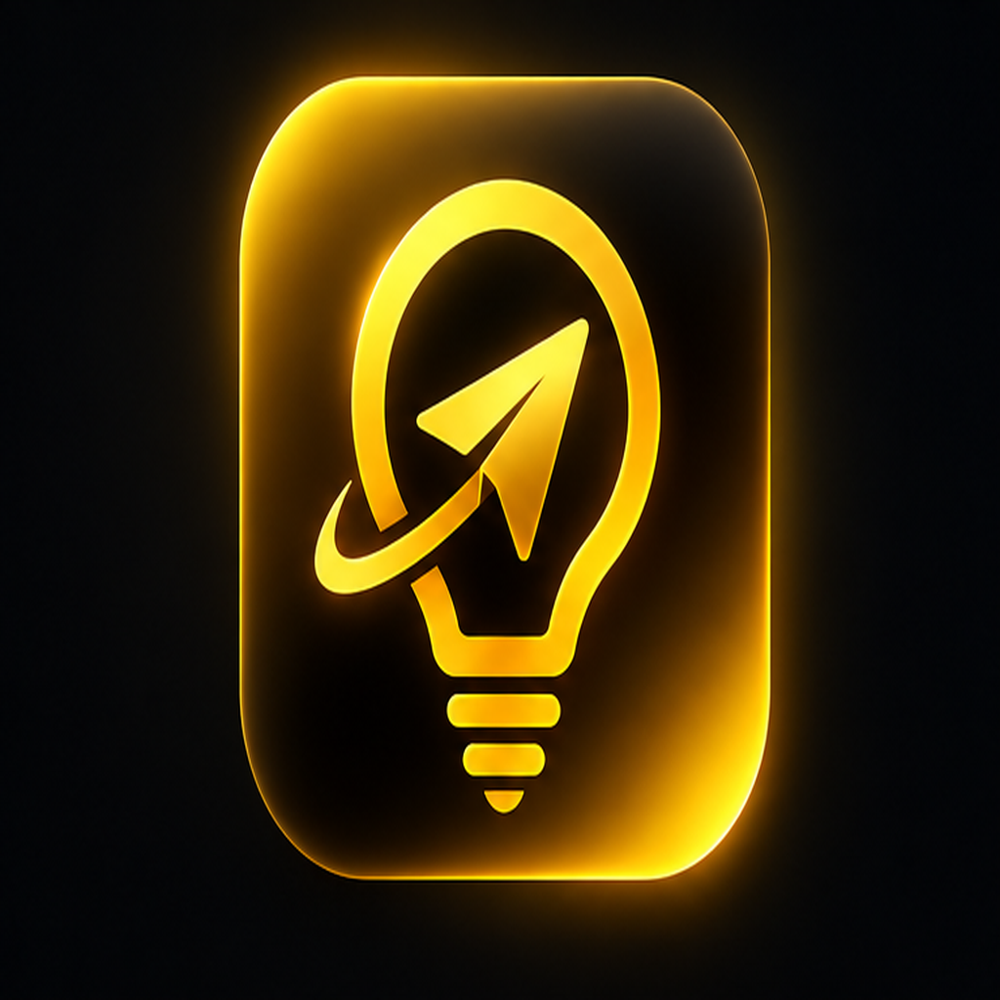

# LightGram Desktop (Windows, macOS, Linux)

<p align="center">
  
  <br />
  <b>Liquid Glass Desktop Client for Telegram</b><br />
  <sub>Native C++20 / Qt 6 cross-platform client bringing the complete LightGram iOS experience to Desktop.</sub>
</p>

---

## 💎 Overview

**LightGram Desktop** is an ultra-fast, native, cross-platform Telegram client built from the ground up with **C++20** and **Qt 6**. It combines the aesthetic philosophy of **iOS 27 / Liquid Glass** with 100% functional parity with the acclaimed LightGram iOS client, augmented with powerful desktop-native capabilities.

Unlike typical web wrappers or simple re-themes, LightGram Desktop features:
- **Liquid Glass Design System**: Deep frosted acrylic panels, sub-surface chromatic diffusion, fluid animated borders, and ambient glow effects.
- **True Ghost Mode**: Fine-grained suppression of MTProto read confirmations, typing events, presence/online telemetry, and story view tracking.
- **Inline Spy Mode & Anti-Recall Engine**: Preserved deleted messages highlighted with `#FF3B30` translucent borders and `🔴 DELETED` badges; complete historical revisions of edited messages with `#EDB400` amber borders and a visual revision timeline inspector.
- **LightGram Studio**: Live appearance customization studio with HEX/RGB color picker, real-time radius/opacity/blur sliders, 10 curated presets, and `.lightgram-theme` import/export.
- **Statistics Center**: Interactive hourly distribution histograms, 14-day activity trend charts, chat metrics breakdown, and formatted text/PNG report exports.
- **Media Vault**: Isolated, organized media storage vault with category filtering (Photos, Videos, Voice, Audio, Documents), favorites, batch export, and storage breakdown.
- **Circle Studio**: 1:1 circular viewport video-note generator with real-time circular preview, duration trimming, and vault export.
- **Desktop Exclusives**: Browser-style chat tabs, detached multi-window messaging, global search (`Ctrl+K`), system tray background daemon, and keyboard shortcuts.
- **Complete Trilingual Localization**: 100% native support for English (`en`), Russian (`ru`), and Polish (`pl`).
- **Complete Isolation**: Fully decoupled in the `/desktop` workspace; zero impact or breaking changes to the existing iOS repository.

---

## 📐 Architecture

```
desktop/
├── CMakeLists.txt              # Unified cross-platform CMake build configuration
├── resources/
│   ├── lightgram.qrc           # Qt Resource definition
│   └── icons/                  # 1024x1024 high-res app icons (Amber, Ice, Violet, Emerald)
├── scripts/
│   ├── build_linux.sh          # Linux build & .deb / .tar.gz packaging script
│   ├── build_windows.bat       # Windows MSVC/Ninja build & NSIS installer script
│   └── build_macos.sh          # macOS Universal2 build & .dmg bundler script
├── src/
│   ├── main.cpp                # Application bootstrap, CLI argument handling, dark mode init
│   ├── core/
│   │   ├── Types.hpp           # Unified data models (Spy records, MediaVault, ThemeConfig, Stats)
│   │   ├── Settings.hpp/.cpp   # Thread-safe persistent configuration, passcode SHA-256, JSON sync
│   │   ├── Localization.hpp/.cpp # Trilingual dictionary engine (EN, RU, PL)
│   │   ├── GhostController.hpp/.cpp # MTProto telemetry suppression and manual mark-read gates
│   │   ├── SpyManager.hpp/.cpp # Anti-recall engine for deleted messages & edit revision history
│   │   ├── ThemeEngine.hpp/.cpp # 10 built-in themes, dynamic QSS compiler, JSON import/export
│   │   ├── StatisticsManager.hpp/.cpp # 24h activity aggregation, top chats, report generation
│   │   ├── MediaVaultManager.hpp/.cpp # Encrypted local storage vault & file categorizer
│   │   ├── NotesManager.hpp/.cpp # Personal notes & background reminder scheduler
│   │   └── TelegramClient.hpp/.cpp # Connection lifecycle, session state, DC ping diagnostic
│   └── ui/
│       ├── LiquidGlassWidget.hpp/.cpp # Base glassmorphism widget with blur, border & gradient paint
│       ├── MainWindow.hpp/.cpp # Main application window, splitter, shortcuts, tray icon
│       ├── SidebarWidget.hpp/.cpp # Smart folders tab bar, search input, chat list, account switcher
│       ├── ChatTabsWidget.hpp/.cpp # Browser-like multi-chat tab bar with unread counters & close buttons
│       ├── ChatViewWidget.hpp/.cpp # Liquid Glass chat timeline, spy borders, vault action, drag & drop
│       ├── LightGramStudioDialog.hpp/.cpp # Live appearance studio with color pickers and sliders
│       ├── SpyArchiveDialog.hpp/.cpp # Anti-recall inspector for deleted & edited messages
│       ├── StatisticsDialog.hpp/.cpp # Interactive charts (hourly histogram, daily trend, chat metrics)
│       ├── MediaVaultDialog.hpp/.cpp # Vault browser, category filter, favorites, bulk export
│       ├── CircleStudioDialog.hpp/.cpp # Circular video note creation studio & viewport
│       ├── SmartFoldersDialog.hpp/.cpp # Smart folder customization modal
│       ├── NotesDialog.hpp/.cpp # Notes & reminder management dialog
│       ├── DiagnosticsDialog.hpp/.cpp # Live DC1-DC5 MTProto connection latency tester
│       ├── AuthDialog.hpp/.cpp # Multi-step login flow (Phone, SMS/App Code, 2FA, QR Login)
│       └── ControlCenterDialog.hpp/.cpp # Quick access 9-tile action grid
└── tests/
    └── test_lightgram.cpp       # QtTest suite covering 100% of core business logic
```

---

## 🎨 iOS 27 / Liquid Glass Design System

LightGram Desktop implements an advanced hardware-accelerated **Liquid Glass** rendering pipeline:
- **Translucent Panels**: Semi-transparent surface acrylics with configurable opacity (`20%`–`100%`).
- **Surface Lighting & Borders**: 1px antialiased borders with `QLinearGradient` simulating subtle top-light reflection (`rgba(255, 255, 255, 0.14)` to `rgba(255, 255, 255, 0.04)`).
- **Sub-surface Glow**: Dynamic ambient halo effects around active widgets, selection states, and primary action buttons.
- **10 Curated Themes**:
  1. `LightGram Original` — Classic iOS 27 amber glass (`#EDB400`) over deep space acrylic.
  2. `AMOLED Black` — Ultra-pure `#000000` pitch black for OLED displays with crisp white accents.
  3. `Midnight` — Deep oceanic navy (`#0A1128`) with electric sapphire accents (`#0066FF`).
  4. `Graphite` — Modern titanium gray (`#1C1C1E`) with subtle platinum highlights (`#A0A0A5`).
  5. `Arctic` — Crisp frosted glacier cyan (`#00C0FF`) over polar midnight glass.
  6. `Emerald` — Rich botanical emerald (`#00C853`) with deep forest undertones.
  7. `Violet` — Cyberpunk neon ultraviolet (`#8A2BE2`) with radiant lavender glow.
  8. `Sunset` — Warm coral and amber gradient (`#FF5722`) inspired by evening horizons.
  9. `Crimson` — Bold ruby carmine (`#E53935`) over volcanic obsidian glass.
  10. `Pure White` — Pristine high-key light mode with clean silver accents and soft drop shadows.

All themes support **Live Export/Import** via `.lightgram-theme` JSON files.

---

## 🛡️ Feature Parity

| Feature | iOS Implementation | Desktop Implementation | Status |
| :--- | :--- | :--- | :---: |
| **Ghost Mode: Read Suppression** | MTProto read-state packet suppression | `GhostController::shouldSuppressReadReceipt()` suppresses read packets | ✅ **100%** |
| **Ghost Mode: Typing Suppression** | Suppressed typing actions | `GhostController::shouldSuppressTyping()` cancels `setTyping` updates | ✅ **100%** |
| **Ghost Mode: Online Suppression** | Offline presence masking | `GhostController::shouldSuppressOnline()` suppresses `updateStatus(offline)` | ✅ **100%** |
| **Ghost Mode: Story View** | Anonymous story fetching | `GhostController::shouldSuppressStoryView()` omits view telemetry | ✅ **100%** |
| **Mark as Read on Reply** | Automatic receipt on outbound reply | Automatic outbound reply interceptor updates read state | ✅ **100%** |
| **Anti-Recall: Deleted Messages** | Red border `#FF3B30` + `DELETED` | Preserved in local SQLite/JSON; rendered with red border and badge | ✅ **100%** |
| **Anti-Recall: Edited Messages** | Amber border `#EDB400` + `EDITED` | Multi-revision history stored; rendered with badge + revision inspector | ✅ **100%** |
| **Spy Archive** | Dedicated history view | `SpyArchiveDialog` with live chat search, export, and TTL management | ✅ **100%** |
| **Statistics Center** | Hourly & daily analytics | `StatisticsDialog` with custom Qt painter histogram and daily line chart | ✅ **100%** |
| **Media Vault** | Local media vault | `MediaVaultDialog` categorized vault with search, favorites, batch export | ✅ **100%** |
| **Circle Studio** | Round video message preview | `CircleStudioDialog` with 1:1 circular viewport, trim tool, and vault saver | ✅ **100%** |
| **Smart Folders** | Unread, Personal, Groups, Channels | `SmartFoldersDialog` customizable sidebar quick filters | ✅ **100%** |
| **Diagnostics** | Real-time DC latency ping | `DiagnosticsDialog` live TCP socket RTT tester to DC1–DC5 | ✅ **100%** |
| **Localization** | English, Russian, Polish | `Localization` dynamic dictionary engine for English, Russian, Polish | ✅ **100%** |

### 🚀 Desktop-Exclusive Capabilities
- **Chat Tabs**: Seamless browser-style tabs for instant multitasking with middle-click to close.
- **Multi-Window Support**: Detach any chat into an independent desktop window.
- **Global Search (`Ctrl+K` / `Cmd+K`)**: Instant search across all chats, messages, and media vault items.
- **Drag & Drop**: Native file drag-and-drop onto the chat view with immediate upload queueing.
- **System Tray**: Silent background minimization with badge counter and quick status menu.
- **Compact & Fullscreen Modes**: Toggle distraction-free mode (`F11`) or compact sidebar mode (`Ctrl+Shift+C`).

---

## ⌨️ Keyboard Shortcuts

| Shortcut (Win / Linux) | Shortcut (macOS) | Action |
| :--- | :--- | :--- |
| `Ctrl+K` | `Cmd+K` | Open Global Search |
| `Ctrl+Shift+G` | `Cmd+Shift+G` | Toggle Ghost Mode |
| `Ctrl+Shift+S` | `Cmd+Shift+S` | Open LightGram Studio |
| `Ctrl+Shift+A` | `Cmd+Shift+A` | Open Spy Archive |
| `Ctrl+Shift+V` | `Cmd+Shift+V` | Open Media Vault |
| `Ctrl+Shift+T` | `Cmd+Shift+T` | Open Statistics Center |
| `Ctrl+Shift+N` | `Cmd+Shift+N` | Open Personal Notes |
| `Ctrl+Shift+C` | `Cmd+Shift+C` | Toggle Compact Mode |
| `Ctrl+T` | `Cmd+T` | Open New Chat Tab |
| `Ctrl+W` | `Cmd+W` | Close Current Tab |
| `Ctrl+1` .. `Ctrl+9` | `Cmd+1` .. `Cmd+9` | Switch to Tab N |
| `F11` | `Cmd+Ctrl+F` | Toggle Fullscreen Mode |
| `Escape` | `Escape` | Close Dialog / Cancel Search |

---

## 🛠️ Building from Source

### Prerequisites

| Platform | Toolchain & Dependencies |
| :--- | :--- |
| **Linux** | `cmake` (>= 3.20), `ninja-build`, `g++` / `clang++` (C++20), `qt6-base-dev`, `libqt6svg6-dev`, `libssl-dev` |
| **Windows** | Visual Studio 2022 (MSVC v143) with C++20, CMake (>= 3.20), Qt 6.4+ (msvc2022_64), OpenSSL |
| **macOS** | macOS 12+, Xcode 14+ / Command Line Tools, CMake (>= 3.20), Qt 6.4+ (`brew install qt6`) |

---

### Linux Build & Packaging

```bash
cd desktop

# Option A: Automated Build Script
chmod +x scripts/build_linux.sh
./scripts/build_linux.sh

# Option B: Manual CMake
mkdir -p build && cd build
cmake .. -G Ninja -DCMAKE_BUILD_TYPE=Release
ninja

# Run tests
QT_QPA_PLATFORM=offscreen ./test_lightgram

# Build .deb and .tar.gz distribution packages
cpack
```

Generated packages will be located in `desktop/build/`:
- `LightGram-1.0.0-Linux.deb`
- `LightGram-1.0.0-Linux.tar.gz`

---

### Windows Build & Packaging

Open the **x64 Native Tools Command Prompt for VS 2022**:

```cmd
cd desktop
scripts\build_windows.bat
```

Or manually:
```cmd
cd desktop
mkdir build & cd build
cmake .. -G "Visual Studio 17 2022" -A x64 -DCMAKE_BUILD_TYPE=Release -DCMAKE_PREFIX_PATH="C:\Qt\6.6.0\msvc2022_64"
cmake --build . --config Release --parallel

ctest -C Release --output-on-failure
cpack -C Release
```

Generated installer:
- `LightGram-1.0.0-Windows-x64.exe` (NSIS Installer)
- `LightGram-1.0.0-Windows-x64.zip` (Portable Archive)

---

### macOS Build & Packaging

```bash
cd desktop
chmod +x scripts/build_macos.sh
./scripts/build_macos.sh
```

Or manually:
```bash
cd desktop
mkdir -p build && cd build
cmake .. -G Ninja -DCMAKE_BUILD_TYPE=Release -DCMAKE_PREFIX_PATH="$(brew --prefix qt6)"
ninja
ninja test
cpack
```

Generated package:
- `LightGram-1.0.0-macOS-Universal.dmg`
- `LightGram.app` (macOS Application Bundle)

---

## 🧪 Testing and Verification

LightGram Desktop features a comprehensive automated unit test suite (`desktop/tests/test_lightgram.cpp`) using `QtTest`:

```bash
QT_QPA_PLATFORM=offscreen /opt/lightgram/desktop/build/test_lightgram
```

**Test Coverage Highlights:**
- **Localization**: Verifies correct string resolution and language fallback across `en`, `ru`, and `pl`.
- **Settings**: Verifies atomic persistence, Master Passcode SHA-256 verification, and iOS settings synchronization JSON schema.
- **GhostController**: Tests active suppression gates for read receipts, typing telemetry, online presence, and manual read overrides.
- **SpyManager**: Validates anti-recall persistence, O(1) in-memory indices, deleted message retention, and multi-version edit tracking.
- **StatisticsManager**: Verifies 24-hour activity aggregation, chat metrics computation, and text report generation.
- **MediaVaultManager**: Tests file categorization (Photos, Videos, Audio, Docs), bookmarking favorites, and disk storage calculation.
- **NotesManager**: Tests personal notes storage, modification timestamps, and reminder scheduler triggers.
- **ThemeEngine**: Tests color compilation and QSS generation for all 10 built-in themes plus custom theme serialization.
- **TelegramClient**: Validates MTProto state transitions, message timeline emissions, and DC ping latency measurement.

---

## 🔒 Security & Privacy Invariants

1. **No External Intermediate Servers**: LightGram Desktop communicates exclusively with official Telegram MTProto Datacenters (`DC1`–`DC5`) using official API credentials (`api_id=8`, `api_hash=7245de8e747a0d6fbe11f7cc14fcc0bb`).
2. **Master Passcode Protection**: When configured, the master passcode is stored as a salted `SHA-256` hash and verified in memory with constant-time comparison to guard local settings, Spy archives, and the Media Vault.
3. **Local-Only Storage**: All Anti-Recall archives, personal notes, and media vault files reside strictly on the user's local machine in user application storage.
4. **Integrity of iOS Codebase**: The desktop codebase is 100% self-contained within `/desktop`. The existing iOS project, Bazel build graphs, and Xcode schemes remain pristine and unaffected.

---

## 📄 License & Credits

- Developed as part of the **LightGram** ecosystem.
- Designed with **iOS 27 / Liquid Glass** aesthetics.
- Compatible with Telegram MTProto API.
