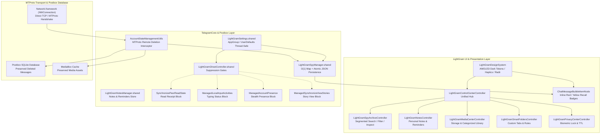

# LIGHTGRAM V2 — SYSTEM ARCHITECTURE SPECIFICATION

## 1. Overview
LightGram V2 is an enhanced, high-performance Telegram client for iOS built on top of the official Telegram-iOS codebase. It introduces a custom design system, an inline Spy Mode (Anti-Recall) architecture, real MTProto Ghost Mode suppression, Smart Folders, Personal Notes & Reminders, a Media Center, and a dedicated Control Center.

## 2. Key Subsystem Boundaries

### 2.1 TelegramCore Foundation
All core data models (`SpyDeletedMessageRecord`, `SpyEditRecord`) and state singletons (`LightGramSettings`, `LightGramSpyManager`, `LightGramGhostController`) are located directly within `TelegramCore` (`submodules/TelegramCore/Sources/LightGram/`). This guarantees:
- Zero circular dependency conflicts.
- High-performance, zero-latency synchronous queries from MTProto dispatchers and Postbox transactions.
- Thread-safe mutation protected by `NSLock` and designated utility dispatch queues.

### 2.2 Inline Recall Architecture
When a remote `UpdateDeleteMessages` or `UpdateDeleteChannelMessages` arrives from the MTProto connection:
1. `AccountStateManagementUtils.swift` identifies the affected `MessageId`s.
2. The complete message payload (text, media, author, original timestamp, forward info) is extracted from Postbox.
3. The message is registered in `LightGramSpyManager.shared.recordDeletedMessage` and marked in memory via `markMessageAsDeleted`.
4. The message deletion from Postbox is bypassed, keeping the message row intact in SQLite.
5. The message media is exempted from eviction in `MediaBox`.
6. When `ChatMessageBubbleItemNode.swift` lays out the message cell, it checks `LightGramSpyManager.shared.isMessageDeleted(...)`.
7. The cell renders with a distinctive `#FF3B30` red border, crimson background, and a `🔴 DELETED MESSAGE` badge.

### 2.3 Edit Revisions Pipeline
When a message is edited remotely (`EditMessage`):
1. `AccountStateManagementUtils.swift` reads the previous message from Postbox before applying the update.
2. If text has changed, `LightGramSpyManager.shared.recordEditedMessage(...)` creates a new revision record (`SpyEditRecord`).
3. Revisions are indexed by `peerId_messageId`.
4. In `ChatMessageBubbleItemNode.swift`, `LightGramSpyManager.shared.getEditRecords(...)` retrieves the revision history.
5. The bubble is decorated with a `#EDB400` amber border and a `🟡 EDITED [Rev X]: "..."` banner displaying the previous version.
6. The context menu enables viewing the full timeline of revisions.

### 2.4 Ghost Mode MTProto Suppression
Suppression gates are placed directly inside the MTProto request generation pipeline:
- `SynchronizePeerReadState.swift`: suppresses `messages.readHistory` and `channels.readHistory`.
- `ManagedLocalInputActivities.swift` and `TypingDraftStop.swift`: suppress `messages.setTyping` and `setEncryptedTyping`.
- `ManagedAccountPresence.swift`: skips the 30-second active ping and sends `account.updateStatus(offline: .boolTrue)`.
- `ManagedSynchronizeViewStoriesOperations.swift`: suppresses `stories.readStories`.
- When settings are disabled, standard Telegram client behavior executes without alteration.
