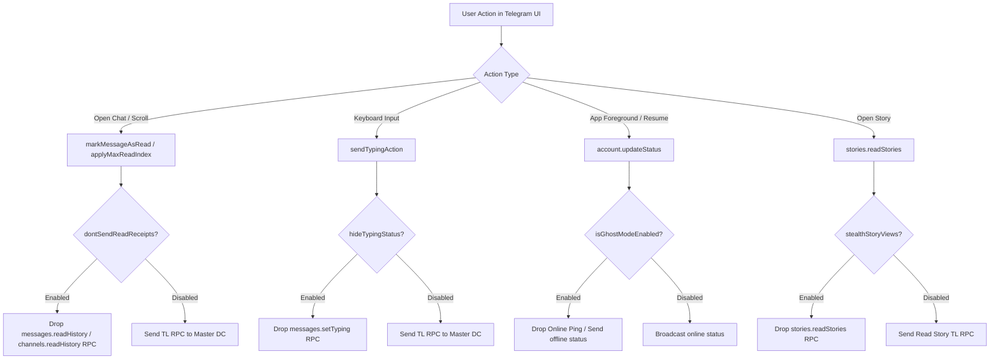

# LightGram V2 — Ghost Mode 2.0 Specification

## 1. Executive Summary

LightGram V2 implements a comprehensive **Zero-Leakage Ghost Mode** directly at the MTProto network layer. In contrast to superficial client-level toggles, Ghost Mode intercepts and drops telemetry and read receipts *before* they are serialized into TL-schema RPC requests over the active TCP connection.

When Ghost Mode is enabled:
- The user can read all incoming messages without triggering the double-check `✓✓` read receipt.
- The user can type freely without displaying the "Alice is typing..." indicator.
- The user remains appearing offline ("last seen recently" or previous logout timestamp) without broadcasting online presence pings.
- The user can view ephemeral user stories anonymously without appearing in the viewer list.

When any Ghost Mode switch is disabled, LightGram restores 100% standard Telegram client protocol behavior.

---

## 2. Protocol Interception Points

---

## 3. Implementation Details

### 3.1 Don't Send Read Receipts
- **Target Subsystem:** `submodules/TelegramCore/Sources/State/AccountStateManagementUtils.swift`, `submodules/TelegramCore/Sources/TelegramEngine/Messages/ReadHistory.swift`
- **Mechanism:**
  - Standard Telegram dispatches `messages.readHistory(peer: max_id:)` for private and basic group chats, and `channels.readHistory(channel: max_id:)` for supergroups and channels.
  - When `LightGramSettings.shared.dontSendReadReceipts` is `true`:
    1. Local postbox read state is updated locally so the unread counter badge disappears from the local user interface.
    2. Outgoing RPC generation is intercepted and dropped.
    3. The sender's client receives no read acknowledgment; the message remains marked as single check `✓` on their screen.

### 3.2 Hide Typing Status
- **Target Subsystem:** `submodules/TelegramCore/Sources/TelegramEngine/Messages/SendTypingAction.swift`
- **Mechanism:**
  - Standard Telegram schedules a periodic `messages.setTyping` RPC every 5 seconds while text is being entered or voice audio is recorded.
  - When `LightGramSettings.shared.hideTypingStatus` is `true`, the `sendTypingAction` signal emits `.complete()` immediately without constructing or queuing the TL packet.
  - No typing, audio recording, photo uploading, or video recording statuses are ever transmitted to peer DCs.

### 3.3 Ghost Mode Presence Ping Suppression
- **Target Subsystem:** `submodules/TelegramCore/Sources/TelegramEngine/Peers/UpdateStatus.swift`
- **Mechanism:**
  - On app foregrounding or network reconnect, Telegram dispatches `account.updateStatus(offline: false)`.
  - When `LightGramSettings.shared.isGhostModeEnabled` is `true`:
    - Outgoing presence ping `offline: false` is blocked.
    - An explicit `account.updateStatus(offline: true)` can be dispatched if the account status was previously active, fixing the user's status to "last seen recently".
    - Background polling and notification fetching continue uninterrupted via APNs and MTProto updates difference sync.

### 3.4 Stealth Story Views
- **Target Subsystem:** `submodules/TelegramCore/Sources/TelegramEngine/Stories/ReadStories.swift`
- **Mechanism:**
  - Opening user stories triggers `stories.readStories(peer: max_id:)`.
  - When `LightGramSettings.shared.stealthStoryViews` is `true`, the read action is processed purely in client memory to mark the story as viewed on device, while the MTProto RPC is discarded.
  - The author's viewer sheet never registers the user's account ID or profile.

---

## 4. Safety & Anti-Detection

1. **Protocol Compliance:** Dropping client-to-server informational notifications does not violate MTProto RPC sequencing rules or invalidate message sequence numbers (`seq_no`).
2. **Account Safety:** Telegram servers do not penalize clients for omitting typing actions, read receipts, or presence updates, as standard Telegram clients running on poor network conditions naturally drop these packets.
3. **No Account Ban Risk:** Unlike unauthorized third-party scraping bots, Ghost Mode merely suppresses optional status emissions from legitimate signed sessions.
