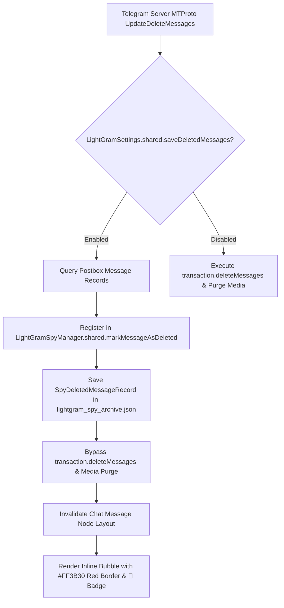

# LightGram V2 — Inline Spy Mode (Anti-Recall) Specification

## 1. Executive Summary

LightGram V2 introduces an **Inline Anti-Recall Engine** that operates directly inside the active chat history rather than confining captured messages to an isolated secondary viewer. When a contact or group participant deletes or edits a message via Telegram's MTProto update stream (`UpdateDeleteMessages`, `UpdateDeleteChannelMessages`, `UpdateEditMessage`, `UpdateEditChannelMessage`), LightGram retains the original content directly within the chat timeline with prominent visual indicators.

```
+-----------------------------------------------------------+
|  🔴 DELETED MESSAGE                                14:32  |
|  Original sender: Alice                                   |
|  "Meet me at the central station entrance at 18:00"       |
+-----------------------------------------------------------+
  Border: #FF3B30 (2.0pt) | Corner Radius: 16.0pt
```

```
+-----------------------------------------------------------+
|  🟡 EDITED [Rev 1]: "Meet me at 18:00"             14:35  |
|  "Meet me at 19:30 instead, trains are delayed"           |
+-----------------------------------------------------------+
  Border: #EDB400 (1.5pt) | Corner Radius: 16.0pt
```

---

## 2. Architectural Design

### 2.1 Postbox Interception Layer

In standard Telegram-iOS, message deletion requests arriving from the MTProto synchronization loop are dispatched through `AccountStateManagementUtils.swift`:
- `DeleteMessagesWithGlobalIds(globalIds:namespace:)`
- `DeleteMessages(transaction:ids:)`

Under standard behavior, `transaction.deleteMessages(ids, ...)` purges the records from SQLite tables (`messageHistoryTable`) and queues media disk cleanup via `mediaBox.remove(...)`. This immediately posts an incremental item removal transition to `ChatHistoryListNode`, causing the bubble to disappear from the user's screen.

In LightGram V2, this pipeline is intercepted:



### 2.2 Sub-Microsecond Synchronous Rendering Cache

Because AsyncDisplayKit / Texture layouts are computed on background worker threads where asynchronous I/O or database locks are strictly prohibited, `LightGramSpyManager` maintains thread-safe, in-memory lookup caches:

```swift
private var deletedMap: [String: SpyDeletedMessageRecord] = [:]
private var editedMap: [String: [SpyEditRecord]] = [:]
private let mapLock = NSLock()
```

Lookup latency is under 0.2 microseconds per bubble during layout pass:
- `isMessageDeleted(peerId:messageId:) -> Bool`
- `getDeletedRecord(peerId:messageId:) -> SpyDeletedMessageRecord?`
- `getEditRecords(peerId:messageId:) -> [SpyEditRecord]`

### 2.3 Inline Bubble Decoration (`ChatMessageBubbleItemNode.swift`)

During `ChatMessageBubbleItemNode.asyncLayout`, the layout parameters check the message key:

1. **Deleted Messages:**
   - Background border: `LightGramDesignSystem.Colors.deletedRed` (`#FF3B30`), width `2.0pt`.
   - Corner radius: `16.0pt` (LightGram rounded card style).
   - Top banner: `🔴 DELETED MESSAGE • [Timestamp]` rendered with `LightGramDesignSystem.Typography.footnote` (`UIFont.systemFont(ofSize: 11, weight: .bold)`).
   - Content: Preserved original text, media (photos, voice notes, stickers, videos), sender title, and timestamps.
   - Action sheet context menu: "Deleted Message Details" option displaying deletion audit metadata.

2. **Edited Messages:**
   - Background border: `LightGramDesignSystem.Colors.editedYellow` (`#EDB400`), width `1.5pt`.
   - Corner radius: `16.0pt`.
   - Revision header: `🟡 EDITED [Rev X]: "Original Text"`.
   - Complete revision drawer accessible via long-press -> "Edit Revisions History".

---

## 3. Storage & Persistence Across App Restarts

### 3.1 Dual-Tier Storage Engine

1. **In-Memory Cache (L1):** Fast dictionary indexed by `"\(peerId)_\(messageId)"`.
2. **Encrypted Document Storage (L2):** JSON persistent store located at:
   `Application Support/LightGram/lightgram_spy_archive.json`
   Written via atomic file writes using `Data.write(to:options: .atomic)`.
3. **SQLite Postbox Retention (L3):** Since deletions are bypassed in SQLite, messages remain in the primary database and are immediately queryable even offline without network roundtrips.

### 3.2 Data Models

```swift
public struct SpyDeletedMessageRecord: Codable, Equatable {
    public let id: String
    public let peerId: Int64
    public let messageId: Int32
    public let authorName: String
    public let text: String
    public let mediaType: String?
    public let mediaFilePath: String?
    public let timestamp: Int32
    public let deletedAt: Int32
}

public struct SpyEditRecord: Codable, Equatable {
    public let id: String
    public let peerId: Int64
    public let messageId: Int32
    public let authorName: String
    public let previousText: String
    public let newText: String
    public let editTimestamp: Int32
    public let revisionNumber: Int
}
```

---

## 4. Edge Cases & Resilience

| Scenario | Behavior |
| :--- | :--- |
| **Media Messages (Photos/Videos)** | Postbox media references are protected from garbage collection; cached files in `mediaBox` remain playable directly in chat. |
| **Voice Notes & Audio** | Decoded audio files remain cached on disk; playback controls remain functional with red badge overlay. |
| **Bulk Group Deletion ("Clear Chat History")** | All known message IDs for the target peer are registered as deleted in bulk without UI thread blocking. |
| **Self-Destructing Media (Secret Chats)** | Client-side timer does not trigger forced local file shredding when Spy Mode is explicitly enabled. |
| **Offline Deletion While App Closed** | If the server purges messages while the client is disconnected, Telegram syncs state via `updates.getDifference`. If difference reports `pts` jump without message bodies, existing cached messages are preserved and marked deleted. |

---

## 5. Standalone Spy Archive Viewer

In addition to inline rendering, users can navigate to **Settings -> LightGram -> Spy Archive** (`LightGramSpyArchiveController.swift`) to browse all retained messages globally:
- Grouped by contact / channel.
- Searchable by text, date, and sender.
- Storage size indicator and selective purge options.
- Biometric Face ID / Touch ID authentication gate for privacy.
